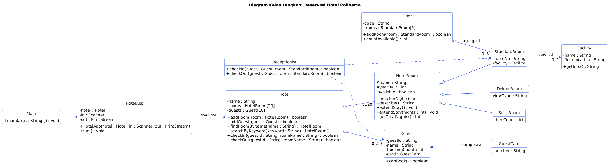
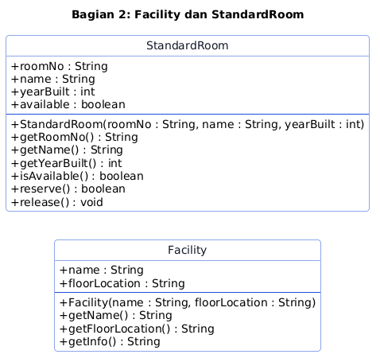
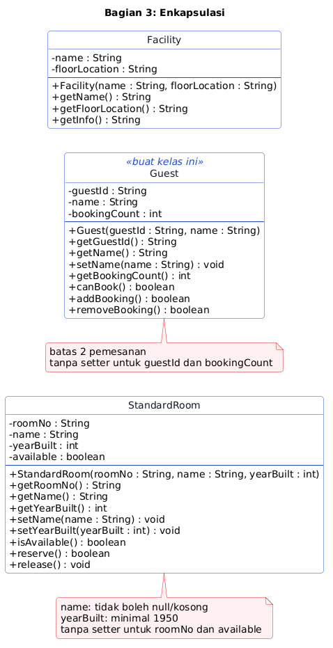
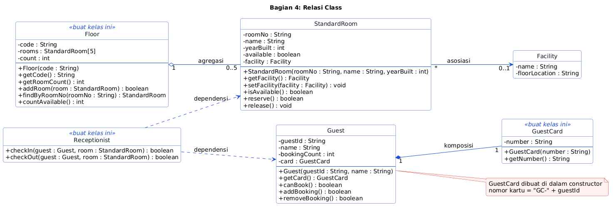
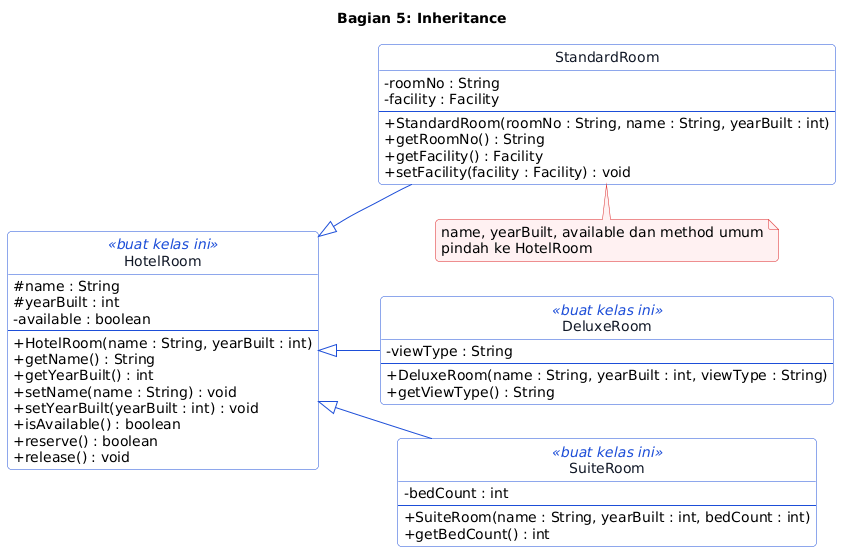
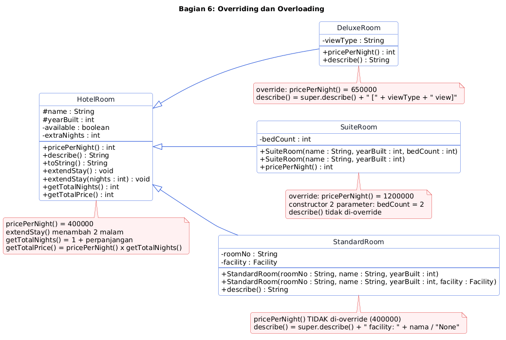
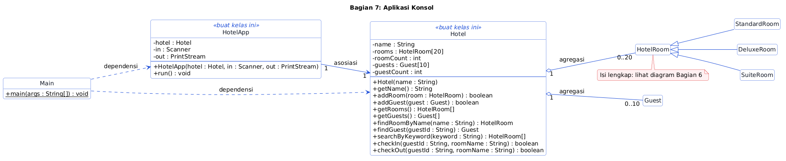

# UTS PBO Varian B: Reservasi Hotel

Aplikasi konsol reservasi hotel, dibangun bertahap dari Bagian 1 sampai 7, lalu dijelaskan lewat video.

## Aturan

- Jangan ubah `src/test/**`, `.github/**`, dan `.wakatime-project`.
- Ikuti diagram persis: nama kelas, field, constructor, dan method.
- Buat semua field `private`, kecuali `name` dan `yearBuilt` di `HotelRoom` (`protected`).
- Pakai array biasa. Jangan pakai `List` atau `ArrayList`.
- Jangan pakai `System.out.println` di `Hotel` dan kelas model. Tampilan hanya di `Main` dan `HotelApp`.
- Nyalakan WakaTime setiap kali mengerjakan (lihat Langkah 0).
- Kerjakan sendiri tanpa bantuan AI. Jangan memakai AI (chatbot, asisten kode, atau autocomplete berbasis AI) untuk menulis kode, menjawab soal, atau menyusun laporan. Kode, video, dan laporan harus hasil kerjamu, dan kamu menjelaskan kodemu langsung di video. Kode atau laporan salinan tidak dinilai.

## Langkah 0: Pasang WakaTime (wajib, sebelum menulis kode apa pun)

WakaTime mencatat waktu kamu mengetik kode. Dosen memakainya untuk menilai usaha.

1. Buat akun gratis di [wakatime.com](https://wakatime.com) dan salin API key dari [wakatime.com/settings/api-key](https://wakatime.com/settings/api-key). Jangan bagikan key ini.
2. Pasang plugin di editormu (NetBeans: `Tools > Plugins`; VS Code: ekstensi `WakaTime`; IntelliJ IDEA: `Settings > Plugins`), lalu tempel API key.
3. Ketik kode beberapa menit, lalu buka [wakatime.com/dashboard](https://wakatime.com/dashboard). Pastikan project **uts-b-hotel** muncul.

`.wakatime-project` berisi `uts-b-hotel`: jangan ubah. Waktu tanpa plugin tidak dihitung.

## Daftar Isi

1. [Studi Kasus](#studi-kasus)
2. [Memulai](#memulai)
3. [Cara Membaca Diagram dan Bantuan](#cara-membaca-diagram-dan-bantuan)
4. [Bagian 1 sampai 7](#bagian-1-pertemuan-1-pengantar)
5. [Coba Aplikasinya](#coba-aplikasinya)
6. [Video Penjelasan](#video-penjelasan-wajib)
7. [Laporan Singkat (PDF)](#laporan-singkat-pdf-2-3-halaman)
8. [Pengumpulan](#pengumpulan)
9. [Penilaian](#penilaian)

## Studi Kasus

Hotel Polinema menyewakan tiga jenis kamar:

- **Standard**: Rp400.000 per malam, punya nomor kamar dan (boleh) satu fasilitas, misalnya kolam renang di lantai tertentu.
- **Deluxe**: Rp650.000 per malam, punya jenis pemandangan (misalnya `City`).
- **Suite**: Rp1.200.000 per malam, punya jumlah tempat tidur.

Setiap **tamu** punya kartu tamu (`GC-` diikuti ID tamu) dan boleh memesan paling banyak **2** kamar sekaligus. Kamar baru dianggap sah jika tahun dibangunnya **1950 atau lebih**. Resepsionis memakai aplikasi konsol untuk menambah kamar, mendaftarkan tamu, check in, check out, dan mencari kamar. Hotel menampung paling banyak 20 kamar dan 10 tamu.

Diagram seluruh kelas ada di bawah. Bagian demi bagian akan menambahkan detailnya.



## Memulai

1. Buka https://github.com/dhanifudin/oop-hotel, klik **Use this template**, lalu **Create a new repository**. Pilih **Private**, lalu undang akun GitHub Dosen (`dhanifudin`) sebagai collaborator (**Settings > Collaborators**).
2. Clone repositori barumu. Pastikan WakaTime aktif.
3. Commit dan push setiap selesai satu bagian.
4. Buka tab **Actions**. Autograder berjalan di setiap push dan menampilkan nilai kodemu.

Jalankan semua tes dan satu kelas tes (butuh JDK 17 atau lebih dan Maven):

```
mvn -q test
mvn -q test -Dtest=P02StandardRoomTest
```

Jalankan aplikasi (menjalankan `Main`, satu-satunya titik awal program):

```
mvn -q compile exec:java
```

Di NetBeans: `File > Open Project`, lalu `Run File` (`Shift+F6`). Di VS Code: pasang "Extension Pack for Java" dan klik `Run` di atas `main`. Baca pesan tes yang gagal: pesannya menjelaskan apa yang kurang.

## Cara Membaca Diagram dan Bantuan

Diagram kelas adalah spesifikasi utama. Semua kelas, field, constructor, dan method yang kamu butuhkan ada di diagram.

| Simbol | Arti |
|---|---|
| `+`, `-`, `#` | `public`, `private`, `protected` |
| `nama : Tipe` | field atau parameter bernama `nama` bertipe `Tipe` |
| `metode() : Tipe` | method yang mengembalikan `Tipe` |
| `<<buat kelas ini>>` | kelas belum ada di starter, kamu yang membuatnya |
| `-->` | asosiasi |
| `o--` | agregasi (belah ketupat kosong) |
| `*--` | komposisi (belah ketupat penuh) |
| `..>` | dependensi |
| `<\|--` | inheritance (`extends`) |
| `0..5`, `1`, `*` | multiplicity (jumlah objek) |

Setiap bagian punya satu kotak **Bantuan**. Coba dulu sendiri, buka Bantuan hanya jika buntu, dan catat di laporan kalau kamu membukanya.

---

## Bagian 1 (Pertemuan 1): Pengantar

### Yang Diuji Oleh Autograder

- Baris **pertama** output `Main` adalah persis `Welcome to Polinema Hotel`.
- Setelah baris itu, kamu bebas menambah baris lain.

### Pikirkan Dulu

- Apa yang terjadi saat kamu menekan Run: apa yang dikerjakan compiler, dan apa yang dikerjakan JVM?
- Method mana yang pertama kali dijalankan Java, dan mengapa harus `static`?

<details>
<summary>Bantuan</summary>

- Cek `java -version`. Kamu butuh versi 17 atau lebih.
- Perintah menampilkan teks berbentuk `System.out.println("teks kamu");`, ditulis di dalam kurung kurawal `main`, diakhiri titik koma.
- Huruf besar-kecil, spasi, dan ejaan harus persis sama dengan teks di soal.
- Jika error: `System` harus berawalan huruf besar, tanda kutip harus berpasangan, dan kode harus berada di dalam `main`.

</details>

### Periksa Hasil

Tes yang harus lulus: `P01MainOutputTest`.

---

## Bagian 2 (Pertemuan 2): Class dan Object



### Yang Diuji Oleh Autograder

- Constructor menyimpan semua parameternya, dan getter mengembalikan nilai yang sama.
- `Facility.getInfo()` mengembalikan teks berbentuk `nama [lantai]`. Contoh: `Rooftop Gym [Floor 9]`.
- Kamar yang baru dibuat **tersedia**.
- `reserve()` berhasil (`true`) satu kali. Selama kamar masih terisi, memanggilnya lagi menghasilkan `false`.
- `release()` membuat kamar bisa dipesan lagi.
- Dua objek `StandardRoom` tidak saling memengaruhi.
- Di bagian ini field boleh `public` (seperti di diagram). Di Bagian 3 kamu akan menutupnya.

### Pikirkan Dulu

- Data apa saja yang perlu diingat setiap objek `StandardRoom`? Mana yang berasal dari parameter, mana yang diatur sendiri oleh objek?
- Agar objek tahu sedang terisi atau tidak, apa yang harus diingatnya? Apa nilai awalnya?
- Di constructor, nama parameter sama dengan nama field. Bagaimana Java membedakannya?

<details>
<summary>Bantuan</summary>

- Deklarasikan field di dalam kelas, di luar method. Tipenya ada di diagram. Kerangka field ada di komentar atas kelas starter.
- Kata kunci `this` menunjuk ke objek yang sedang dikerjakan. Pakai di sisi kiri: `this.nama = nama;`.
- Status "terisi atau tidak" cocok disimpan sebagai `boolean`.
- Method `boolean` boleh punya dua `return` berbeda: periksa kondisi lebih dulu, baru ubah status.
- Di `Main`, coba buat dua `StandardRoom` dan cetak datanya untuk melihat bahwa objek berdiri sendiri.

</details>

### Uji Pemahaman

Tidak dinilai (tulis di laporan atau jelaskan di video): tebak output kode ini dan gambar `a`, `b`, `c` di stack dan objeknya di heap.

```java
StandardRoom a = new StandardRoom("101", "Garden Room", 2015);
StandardRoom b = a;
b.reserve();
System.out.println(a.isAvailable());
StandardRoom c = new StandardRoom("102", "Lake View", 1999);
System.out.println(c.isAvailable());
```

### Periksa Hasil

Tes yang harus lulus: `P02FacilityTest` dan `P02StandardRoomTest`.

---

## Bagian 3 (Pertemuan 3): Enkapsulasi



### Yang Diuji Oleh Autograder

Semua kelas:

- Semua field `private`. Bandingkan diagram Bagian 3 dengan Bagian 2.

`StandardRoom`:

- Nama `null`, kosong, atau hanya spasi **ditolak**. Tahun dibangun **di bawah 1950** ditolak (1950 diterima).
- Penolakan berarti `IllegalArgumentException` dilempar dan nilai lama **tetap**.
- Constructor juga menolak data tidak valid. `roomNo` tidak boleh kosong.
- `roomNo` read-only (tanpa setter). Status tersedia tidak punya setter dan hanya berubah lewat `reserve()` dan `release()`.

`Guest` (kelas ini kamu isi dari stub sesuai diagram):

- `guestId` dan `bookingCount` read-only (tanpa setter). `guestId` dan nama tidak boleh kosong.
- `setName` menolak nama kosong dan menjaga nama lama.
- Jumlah pemesanan selalu antara 0 dan **2**. `addBooking()` dan `removeBooking()` mengembalikan `true` jika berhasil dan `false` jika sudah di batas.
- `canBook()` menjawab apakah tamu masih boleh memesan.

### Pikirkan Dulu

- Jika `Guest` punya `public int bookingCount`, baris kode apa yang merusak aturan "maksimal 2"? Bagaimana `private` mencegahnya?
- Constructor dan setter punya aturan validasi yang sama. Bagaimana menghindari menulis aturannya dua kali?
- Apakah `canBook()` perlu field sendiri? Apa yang terjadi jika datanya tidak sinkron dengan `bookingCount`?
- Mengapa `guestId` tidak boleh punya setter?

<details>
<summary>Bantuan</summary>

- Ubah modifier field, lalu lihat apa yang error di `Main` kamu. Itu pelajaran enkapsulasinya.
- Urutan aman di setter: **periksa dulu**, baru isi field. Jika tidak valid, hentikan dengan `throw new IllegalArgumentException("pesan")` sebelum field disentuh.
- Cek `null` **lebih dulu** sebelum memanggil method pada String. `String` punya method untuk memeriksa teks kosong atau hanya spasi.
- Constructor boleh memanggil setter milik kelasnya sendiri, sehingga aturan nama dan tahun ditulis sekali.
- `canBook()` dihitung langsung dari `bookingCount` setiap kali dipanggil, tanpa field baru. `addBooking()` cukup memanfaatkan `canBook()`, supaya angka batas hanya ada di satu tempat.
- `removeBooking()` punya batas bawah yang berbeda dari batas atas. Tulis hanya getter untuk `guestId` dan `bookingCount`.

</details>

### Uji Pemahaman

Tidak dinilai: tulis satu baris kode di `Main` yang akan merusak aturan "maksimal 2 pemesanan" jika `bookingCount` `public`. Mengapa baris itu tidak bisa dikompilasi setelah field menjadi `private`?

### Periksa Hasil

Tes yang harus lulus: `P03EncapsulationTest` dan `P03GuestTest`. Tes Bagian 2 tidak boleh rusak.

---

## Bagian 4 (Pertemuan 4): Relasi Class



### Yang Diuji Oleh Autograder

`StandardRoom` dan `Facility` (asosiasi):

- Kamar baru belum punya fasilitas. `getFacility()` mengembalikan objek `Facility` **yang sama** dengan yang diberikan ke `setFacility`, dua kamar boleh berbagi satu `Facility`, dan `setFacility(null)` melepasnya.

`Guest` dan `GuestCard` (komposisi):

- Setiap `Guest` punya kartu dengan nomor berbentuk `GC-` diikuti `guestId`. Contoh: `GC-G001`.
- Kartu **tidak** diberikan dari luar. `Guest` tidak punya constructor yang menerima `GuestCard`. Dua tamu punya dua kartu berbeda.

`Floor` (agregasi):

- Kapasitas lantai **5** kamar. `addRoom` mengembalikan `false` jika lantai penuh atau kamarnya `null`.
- `findByRoomNo` mengembalikan objek `StandardRoom` yang sama (bukan salinan), atau `null` jika tidak ada.
- `countAvailable` menghitung kamar yang saat ini tersedia.

`Receptionist` (dependensi):

- Tidak punya field sama sekali.
- `checkIn(guest, room)` berhasil hanya jika tamu boleh memesan **dan** kamar tersedia. Jika berhasil, kamar terisi dan pemesanan tamu bertambah. Jika gagal, tidak ada yang berubah.
- `checkOut(guest, room)` berhasil hanya jika kamar sedang terisi dan tamu punya pemesanan. Jika berhasil, kamar tersedia lagi dan pemesanan tamu berkurang.

### Pikirkan Dulu

Jawab untuk **setiap** garis relasi di diagram:

- Siapa yang **membuat** objek di ujung garis: kelas ini sendiri, atau kode di luarnya?
- Jika pemilik objek dibuang, apakah objek di ujung garis ikut hilang?
- Apakah objek di ujung garis perlu disimpan sebagai **field**, atau cukup muncul sebagai **parameter** method?
- Apa arti `0..5` dan `0..1` pada garis tersebut?

<details>
<summary>Bantuan</summary>

- Relasi yang disimpan sebagai field berarti kelas **mengingat** objek itu. Dependensi tidak mengingat apa pun.
- Asosiasi: `setFacility` hanya **menyimpan referensi**. Jangan membuat `Facility` baru di dalamnya.
- Komposisi: field `card` diisi **di dalam constructor** `Guest` setelah validasi lolos, bukan dari parameter. Jangan membuat kartu baru setiap `getCard()` dipanggil.
- Array di Java berukuran tetap. Kamu butuh satu variabel penghitung untuk tahu berapa slot yang terisi. Telusuri hanya slot yang terisi, dan bandingkan teks dengan `equals`, bukan `==`.
- `Receptionist`: method `Guest` dan `StandardRoom` yang sudah ada menjawab sebagian besar pertanyaanmu. Panggil, jangan tulis ulang aturannya.
- Urutan pemeriksaan penting. Apa yang terjadi jika kamu memesan kamarnya dulu, baru sadar tamunya sudah mencapai batas?

</details>

### Uji Pemahaman

Tidak dinilai: jika objek `Guest` dibuang, apa yang terjadi pada `GuestCard`-nya? Jika objek `Floor` dibuang, apa yang terjadi pada `StandardRoom` di dalamnya? Jelaskan perbedaan keduanya.

### Periksa Hasil

Tes yang harus lulus: `P04AssociationTest`, `P04FloorAggregationTest`, `P04GuestCardCompositionTest`, dan `P04ReceptionistDependencyTest`.

---

## Bagian 5 (Pertemuan 6): Inheritance



### Yang Diuji Oleh Autograder

- `StandardRoom`, `DeluxeRoom`, dan `SuiteRoom` adalah subclass langsung dari `HotelRoom`.
- `HotelRoom` memvalidasi `name` dan `yearBuilt` seperti `StandardRoom` di Bagian 3. Field `name` dan `yearBuilt` bersifat `protected`, dan tidak ada field `public`.
- `StandardRoom` tidak lagi menyimpan `name`, `yearBuilt`, dan status tersedia sendiri, dan tidak menulis ulang method yang sama dengan `HotelRoom`.
- `DeluxeRoom` dan `SuiteRoom` menyimpan data khususnya sesuai diagram (`private`). Getter nama dan tahun serta `reserve`/`release` dipakai dari `HotelRoom`. `DeluxeRoom` menolak `viewType` kosong dengan `IllegalArgumentException`.
- Validasi setter ikut berlaku di semua subclass.
- Semua tes Bagian 2 sampai 4 masih lulus.

### Pikirkan Dulu

- Bandingkan `StandardRoom` di diagram Bagian 4 dengan `DeluxeRoom` di Bagian 5. Apa yang **sama**? Apa yang **khusus**?
- "`SuiteRoom` adalah sebuah `HotelRoom`" masuk akal. Apakah "`Hotel` adalah sebuah `StandardRoom`" juga masuk akal?
- Mengapa `name` dan `yearBuilt` ditandai `#` dan bukan `-`?
- Jika `HotelRoom` punya constructor yang meminta `name` dan `yearBuilt`, siapa yang harus mengisinya saat `DeluxeRoom` dibuat?

<details>
<summary>Bantuan</summary>

- `extends` menyatakan hubungan IS-A. Constructor tidak diwariskan: subclass memanggil `super(...)` sebagai **baris pertama**.
- Kerjakan bertahap dan jalankan seluruh tes setelah setiap langkah: (1) buat `HotelRoom` dengan menyalin field `name`, `yearBuilt`, `available` dan method umum dari `StandardRoom` (`getName`, `setName`, `getYearBuilt`, `setYearBuilt`, `isAvailable`, `reserve`, `release`); (2) ubah `StandardRoom` menjadi `extends HotelRoom`, panggil `super(name, yearBuilt)` lebih dulu, lalu periksa `roomNo`; (3) hapus duplikat dari `StandardRoom`; (4) buat `DeluxeRoom` dan `SuiteRoom` dengan pola yang sama.
- Constructor `HotelRoom` mengisi nama dan tahun lewat setter-nya dan membuat status tersedia `true`.
- Error "constructor HotelRoom ... cannot be applied to given types" berarti sebuah subclass belum memanggil `super(...)` dengan argumen yang sesuai.

</details>

### Uji Pemahaman

Tidak dinilai: apa yang diwarisi `DeluxeRoom` dari `HotelRoom`, dan apa yang tidak? Mengapa constructor `HotelRoom` tidak ikut diwariskan, tetapi tetap harus dipanggil saat `DeluxeRoom` dibuat?

### Periksa Hasil

Tes yang harus lulus: `P06InheritanceTest`. Tes Bagian 2 sampai 4 tidak boleh rusak.

---

## Bagian 6 (Pertemuan 7): Overriding dan Overloading



### Yang Diuji Oleh Autograder

Method baru di `HotelRoom` (baca daftarnya di diagram):

- `pricePerNight()` mengembalikan **400000**.
- `describe()` mengembalikan deskripsi singkat, dan `toString()` mengembalikan hasil yang sama dengan `describe()`.
- `extendStay()` menambah perpanjangan **2** malam. `extendStay(int nights)` menambah sebanyak `nights`, dan menolak 0 atau negatif dengan `IllegalArgumentException`.
- `getTotalNights()` adalah **1** malam menginap ditambah semua perpanjangan.
- `getTotalPrice()` adalah `pricePerNight()` dikali `getTotalNights()`.

Nilai yang diharapkan:

| Objek | `pricePerNight()` | `describe()` |
|---|---|---|
| `HotelRoom("Generic", 2000)` | 400000 | `Generic (built 2000)` |
| `StandardRoom` tanpa fasilitas | 400000 | `Garden Room (built 2015) facility: None` |
| `StandardRoom` dengan fasilitas Swimming Pool | 400000 | `Garden Room (built 2015) facility: Swimming Pool` |
| `DeluxeRoom("Skyline Deluxe", 2018, "City")` | 650000 | `Skyline Deluxe (built 2018) [City view]` |
| `SuiteRoom("Royal Suite", 2021, 3)` | 1200000 | `Royal Suite (built 2021)` |

Constructor baru (lihat diagram):

- `StandardRoom(roomNo, name, yearBuilt, facility)` langsung mengisi fasilitas.
- `SuiteRoom(name, yearBuilt)` memberi jumlah tempat tidur **2**. Versi 3 parameter tetap berfungsi.

Struktur:

- `DeluxeRoom` dan `SuiteRoom` meng-override `pricePerNight()`. `StandardRoom` **tidak** meng-override-nya. `StandardRoom` dan `DeluxeRoom` meng-override `describe()`, `SuiteRoom` tidak.

### Pikirkan Dulu

- Bandingkan `describe()` milik `StandardRoom` dan milik `HotelRoom`. Bagian mana yang sudah dikerjakan parent? Perlukah kamu menulisnya ulang?
- `StandardRoom` tidak punya `pricePerNight()` sendiri. Mengapa? Versi siapa yang berjalan?
- `extendStay()` dan `extendStay(int)` sama-sama bernama `extendStay`. Apa yang membedakannya bagi compiler? Bisakah salah satu memakai yang lain?
- Mengapa `getTotalPrice()` cukup ditulis sekali di `HotelRoom`, tetapi hasilnya berbeda untuk Deluxe dan Suite?

<details>
<summary>Bantuan</summary>

- Pasang `@Override` pada setiap override: compiler menolak jika nama atau parameter salah.
- `super.describe()` memanggil versi milik parent. Teks `None` hanya dipakai jika fasilitas bernilai `null`. `toString()` cukup memanggil `describe()`.
- Overload: `extendStay()` tidak perlu mengulang isi `extendStay(int)`, cukup memanggilnya dengan angka 2. Simpan total perpanjangan di sebuah field `private` di `HotelRoom`.
- `getTotalPrice()` harus memanggil **method** `pricePerNight()`, bukan menulis angka langsung. Itulah polymorphism: objek yang menentukan versi method yang berjalan.
- Constructor boleh memanggil constructor lain di kelas yang **sama** dengan `this(...)` (juga harus baris pertama). Pakai ini untuk `StandardRoom` 4 parameter dan `SuiteRoom` 2 parameter.
- Cara memeriksa tanpa tes: taruh `StandardRoom`, `DeluxeRoom`, dan `SuiteRoom` dalam satu array `HotelRoom[]`, cetak `pricePerNight()` dan `describe()` tiap elemen, lalu bandingkan dengan tabel di atas.

</details>

### Uji Pemahaman

Tidak dinilai: buat array `HotelRoom[]` berisi satu kamar tiap jenis, lalu cetak `pricePerNight()` masing-masing dengan satu perulangan. Variabelnya bertipe `HotelRoom`, tetapi hasilnya `400000`, `650000`, `1200000`. Siapa yang menentukan versi method mana yang berjalan: tipe variabel atau objeknya?

### Periksa Hasil

Tes yang harus lulus: `P07OverrideTest` dan `P07OverloadTest`.

---

## Bagian 7 (Gabungan P1 sampai P7): Aplikasi Konsol



### Pikirkan Dulu

- `Hotel` tidak boleh mencetak apa pun. Mengapa? Apa yang kamu ganti jika tampilannya menjadi GUI, dan apa yang tidak perlu disentuh?
- Array `rooms` berisi `StandardRoom`, `DeluxeRoom`, dan `SuiteRoom` sekaligus. Mengapa itu diizinkan? Konsep apa namanya?
- Mengapa `HotelApp` menerima `Scanner` dan `PrintStream` lewat constructor, bukan langsung memakai `System.in` dan `System.out`?
- Pada alur "check in": objek mana yang dipanggil, dan method apa yang berjalan di masing-masingnya?

### Yang Diuji Oleh Autograder: kelas `Hotel`

Buat kelas `Hotel` sesuai diagram. Tidak boleh ada `System.out` di dalamnya.

| Method | Aturan |
|---|---|
| `addRoom` | `false` jika `null` atau array penuh (20 kamar). |
| `addGuest` | `false` jika `null`, penuh (10 tamu), atau `guestId` sudah terdaftar. |
| `getRooms`, `getGuests` | Array baru yang **hanya berisi elemen terisi**. |
| `findRoomByName` | Nama dicocokkan **tanpa peduli huruf besar-kecil**. `null` jika tidak ada. |
| `findGuest` | Berdasarkan `guestId`. `null` jika tidak ada. |
| `searchByKeyword` | Semua kamar yang namanya **memuat** kata kunci (tanpa peduli huruf besar-kecil). Jika tidak ada, kembalikan array **kosong**, bukan `null`. |
| `checkIn(guestId, roomName)` | `true` hanya jika tamu ada, kamar ada, tamu boleh memesan, dan kamar tersedia. Setelah itu kamar terisi dan pemesanan tamu bertambah. |
| `checkOut(guestId, roomName)` | `true` hanya jika tamu dan kamar ada, kamar sedang terisi, dan tamu punya pemesanan. Setelah itu kamar tersedia lagi dan pemesanan tamu berkurang. |

### Kelas `HotelApp`

`HotelApp` punya tiga field (`hotel`, `in`, `out`), constructor `HotelApp(Hotel hotel, Scanner in, PrintStream out)`, dan method `run()` yang mengulang menu sampai pengguna memilih `0` atau input habis. Semua tampilan memakai `out` dan semua pembacaan memakai `in`, **bukan** `System.out` dan `System.in`: itu yang membuat autograder bisa "mengetik" menu untuk aplikasimu.

Aturan input:

- Baca satu baris, buang spasi di ujung (`trim`). Prompt dicetak dengan `print` (tanpa pindah baris).
- Bilangan (tahun dan jumlah tempat tidur) dibaca sebagai bilangan bulat positif. Jika isinya bukan bilangan positif, cetak `Not a valid number` dan batalkan penambahan.
- Selain itu, pembuatan objek ditaruh di dalam `try`. Jika constructor melempar `IllegalArgumentException` (nomor kamar atau nama kosong, tahun di bawah 1950, ID tamu kosong, dan seterusnya), tangkap lalu cetak `Rejected: ` diikuti pesan exception. Pesannya bebas, tetapi awalan `Rejected` harus ada.
- Menu 2: `Room no`, `Name`, dan `Year built` dibaca dan kamar dibuat dulu. Data fasilitas dibaca **setelah** kamar berhasil dibuat.

### Teks yang harus dicetak

`Main` mencetak sapaan, membuat `Hotel` bernama `Polinema Hotel` berisi data contoh (minimal satu kamar tiap jenis dan satu tamu), lalu menjalankan `HotelApp` dengan `System.in` dan `System.out`. Tulis output **persis** seperti tabel (satu huruf berbeda membuat tes gagal).

| Menu | Prompt (berurutan) | Hasil |
|---|---|---|
| (tiap putaran) | Judul `=== <nama hotel> ===`, lalu baris `1. List rooms`, `2. Add standard room`, `3. Add deluxe room`, `4. Add suite`, `5. Register guest`, `6. Check in`, `7. Check out`, `8. Search rooms`, `9. List guests`, `0. Exit`, lalu prompt `Choose: ` | menu tampil lagi setelah setiap aksi |
| 1 List rooms | tidak ada | Satu baris per kamar: `describe() \| status \| harga/night`. Status: `Available` atau `Occupied`. Harga = `pricePerNight()`. Jika kosong: `No rooms` |
| 2 Add standard room | `Room no: `, `Name: `, `Year built: `, `Facility name (blank for none): `, lalu `Facility floor: ` hanya jika nama fasilitas tidak kosong | `Room added`, atau `Hotel is full` |
| 3 Add deluxe room | `Name: `, `Year built: `, `View type: ` | `Room added`, atau `Hotel is full` |
| 4 Add suite | `Name: `, `Year built: `, `Bed count: ` | `Room added`, atau `Hotel is full` |
| 5 Register guest | `Guest ID: `, `Name: ` | `Guest registered`, atau `Guest ID already exists` |
| 6 Check in | `Guest ID: `, `Room name: ` | `Check-in successful`, atau `Check-in failed` |
| 7 Check out | `Guest ID: `, `Room name: ` | `Check-out successful`, atau `Check-out failed` |
| 8 Search rooms | `Keyword: ` | Satu baris per hasil (format sama dengan menu 1). Jika tidak ada: `No rooms found` |
| 9 List guests | tidak ada | Satu baris per tamu: `G001 - Rina (1 bookings)`. Jika kosong: `No guests` |
| 0 Exit | tidak ada | `Thank you, goodbye`, lalu program selesai |
| lainnya | tidak ada | `Unknown option` |

Contoh baris menu 1: `Skyline Deluxe (built 2018) [City view] | Occupied | 650000/night`.

<details>
<summary>Bantuan</summary>

**Hotel**

- Dua array (`rooms` dan `guests`) masing-masing perlu penghitung isi, seperti di `Floor`. Tipe elemen array kamar adalah `HotelRoom`, sehingga ketiga jenis kamar bisa masuk bersama.
- Untuk memotong array menjadi hanya bagian yang terisi, pelajari `java.util.Arrays.copyOf` (memakai `Arrays` untuk array biasa tetap sesuai aturan).
- Untuk mengabaikan huruf besar-kecil, `String` punya method khusus perbandingan dan method untuk mengubah huruf. Ulangi dari 0 sampai sebelum penghitung, bukan sampai panjang array.
- `addGuest`: sama seperti `addRoom`, ditambah pemeriksaan `findGuest` agar ID tidak kembar.
- `searchByKeyword`: panjang hasil belum diketahui sebelum menghitung, jadi tampung dulu di array sementara lalu potong dengan `Arrays.copyOf`.
- `checkIn` dan `checkOut`: cari, periksa, ubah. Cukup memanggil method yang sudah ada di `Guest` dan `HotelRoom`. Pastikan tamu diperiksa **sebelum** kamar diubah.

**HotelApp**

- Kerangka perulangan dan pembacaan input (boleh disalin, ini bukan inti latihan):

```java
public void run() {
    while (true) {
        printMenu();
        if (!in.hasNextLine()) {      // input habis: berhenti, jangan crash
            return;
        }
        String choice = in.nextLine().trim();
        switch (choice) {
            case "1": showRooms(); break;
            // ... case 2 sampai 9 memanggil method masing-masing
            case "0":
                out.println("____");
                return;
            default:
                out.println("____");
        }
    }
}

private String readLine(String prompt) {
    out.print(prompt);
    return in.hasNextLine() ? in.nextLine().trim() : "";
}

// Mengembalikan -1 jika isinya bukan bilangan bulat positif.
private int readInt(String prompt) {
    String text = readLine(prompt);
    if (text.isEmpty() || text.length() > 9) {
        return -1;
    }
    for (int i = 0; i < text.length(); i++) {
        if (!Character.isDigit(text.charAt(i))) {
            return -1;
        }
    }
    int value = Integer.parseInt(text);
    return value > 0 ? value : -1;
}
```

- Kerjakan satu method sekali: `showRooms`, lalu `checkIn` dan `checkOut`, lalu `showGuests`, `registerGuest`, `searchRooms`, dan terakhir tiga method tambah kamar. Jalankan `P08HotelAppTest` setelah beberapa method selesai.
- Semua handler berpola sama: **baca input**, **periksa**, **serahkan ke `hotel`**, lalu **cetak hasil**. `HotelApp` tidak memutuskan boleh atau tidaknya check in. Keputusan itu milik `Hotel`.
- Satu baris kamar dipakai `showRooms` dan `searchRooms`: tulis di satu method bantu. Pesan "Room added" dan "Hotel is full" juga bisa dipakai bersama.
- `printMenu`: satu `println` untuk judul (nama hotel diminta dari `hotel`), sepuluh `println` untuk baris menu, lalu satu `print` untuk `Choose: `.
- `Main`: cetak sapaan, buat `Hotel`, buat beberapa objek (kamar tiap jenis, satu `Facility`, satu `Guest`) dan tambahkan, lalu `new HotelApp(hotel, new Scanner(System.in), System.out).run()`.

</details>

### Uji Pemahaman

Tidak dinilai: ikuti satu alur check in dari menu 6 sampai selesai. Sebutkan urutan objek yang dipanggil (`HotelApp`, `Hotel`, `Guest`, `HotelRoom`) dan method yang berjalan di masing-masing. Ini juga akan kamu peragakan di video.

### Periksa Hasil

Tes yang harus lulus: `P08HotelTest` dan `P08HotelAppTest`. Setelah itu jalankan aplikasi dan coba semua menu.

---

## Coba Aplikasinya

```
mvn -q compile exec:java
```

Contoh sesi (data awal: kamar `Garden Room` dengan fasilitas `Swimming Pool`, `Skyline Deluxe`, `Royal Suite`, dan tamu `G001 - Rina`):

```
Welcome to Polinema Hotel
=== Polinema Hotel ===
...
Choose: 6
Guest ID: G001
Room name: Skyline Deluxe
Check-in successful
...
Choose: 1
Garden Room (built 2015) facility: Swimming Pool | Available | 400000/night
Skyline Deluxe (built 2018) [City view] | Occupied | 650000/night
Royal Suite (built 2021) | Available | 1200000/night
...
Choose: 9
G001 - Rina (1 bookings)
...
Choose: 0
Thank you, goodbye
```

## Video Penjelasan (wajib)

Rekam video **minimal 10 menit, tanpa batas maksimal** yang memperlihatkan **wajahmu dan layarmu**. Unggah ke YouTube sebagai **Unlisted**, lalu tempel linknya di `video/LINK.md`. Isi video, berurutan:

1. **Pengenalan**: nama, NIM, nomor absen, dan varian (Varian B: Reservasi Hotel).
2. **Telusuri diagram dan kodemu**: bandingkan diagram dengan kode yang kamu tulis. Jelaskan enkapsulasi; empat relasi kelas (asosiasi, agregasi, komposisi, dependensi) dan **bedakan agregasi dari komposisi dengan menunjuk baris kodenya**; inheritance; serta override dibanding overload.
3. **Demo langsung**: jalankan `mvn test`, lalu jalankan aplikasi dan peragakan satu alur transaksi lengkap (daftar tamu, tambah kamar, check in, lihat daftar, check out) dan **satu kasus gagal** (misalnya check in ketiga oleh tamu yang sama, atau tahun dibangun 1949).
4. **Jawab 3 pertanyaan teori dari bank soal**, satu dari setiap kategori. Dosen mengumumkan bank soal. Nomor soal ditentukan nomor absen (1 sampai 28), bukan NIM:
   - Soal 1 (Konsep dan enkapsulasi), nomor 1 sampai 4 = (bagian bulat dari (nomor absen - 1) / 4) mod 4, lalu + 1.
   - Soal 2 (Relasi kelas), nomor 5 sampai 8 = ((nomor absen - 1) mod 4) + 5.
   - Soal 3 (Inheritance, override, overload), nomor 9 sampai 14 = ((nomor absen - 1) mod 6) + 9.
   - Contoh: nomor absen 28 memberi soal 3, 8, dan 12.
5. **Refleksi**: bagian yang paling sulit dan apa yang kamu pelajari.

Rubrik video disediakan oleh dosen (`rubrik-video.md`, dibagikan terpisah). Video yang tidak ada atau terbukti bukan kodemu mengurangi nilai kode (lihat [Penilaian](#penilaian)).

## Laporan Singkat (PDF, 2-3 halaman)

Serahkan satu file PDF: `laporan/Laporan_<NIM>_<Nama>.pdf`, contoh `laporan/Laporan_2441720001_Rina_Wijaya.pdf`. Isi laporan:

1. **Identitas**: nama, NIM, nomor absen, kelas, varian, link repositori GitHub, dan link video YouTube.
2. **Hasil pengujian**: screenshot `mvn test` atau tab Actions yang menampilkan nilai.
3. **Bukti WakaTime**: screenshot dashboard project `uts-b-hotel` dan total jam dalam teks.
4. **Refleksi**: konsep yang masih membingungkan dan rencana belajarmu.
5. **Pernyataan kejujuran**: tulis bahwa kode, video, dan laporan ini kamu kerjakan sendiri tanpa bantuan AI.

## Pengumpulan

Kumpulkan **seluruh repositori**. Sebelum batas waktu, pastikan:

- [ ] WakaTime aktif selama kamu mengerjakan, dan project `uts-b-hotel` muncul di dashboard.
- [ ] Semua kode sudah di-push dan autograder di tab Actions sudah berjalan.
- [ ] `video/LINK.md` berisi link YouTube unlisted yang bisa dibuka.
- [ ] `laporan/Laporan_<NIM>_<Nama>.pdf` ada, bernama benar, dan sudah di-push.
- [ ] Laporan memuat screenshot `mvn test`/Actions, screenshot WakaTime, refleksi, dan pernyataan kejujuran.
- [ ] `.wakatime-project` tidak berubah.

Kirim link repositori sesuai arahan Dosen.

## Penilaian

Polymorphism muncul sebagai konsep pengantar di studi kasus, tetapi tidak dinilai (tidak ada di tes, video, maupun bank soal).

| Komponen | Bobot |
|---|---|
| Kode (autograder) | 40% |
| Video penjelasan | 40% |
| Laporan | 10% |
| Usaha (WakaTime) | 10% |

Jika video tidak ada atau terbukti bukan kodemu, nilai kode dikali 0,5. Laporan atau kode salinan tidak dinilai.

Autograder menilai kode dengan total 100 poin:

| Tes | Bagian | Poin |
|---|---|---|
| `P01MainOutputTest` | 1 | 5 |
| `P02FacilityTest` | 2 | 5 |
| `P02StandardRoomTest` | 2 | 10 |
| `P03EncapsulationTest` | 3 | 10 |
| `P03GuestTest` | 3 | 10 |
| `P04AssociationTest` | 4 | 5 |
| `P04FloorAggregationTest` | 4 | 10 |
| `P04GuestCardCompositionTest` | 4 | 5 |
| `P04ReceptionistDependencyTest` | 4 | 5 |
| `P06InheritanceTest` | 5 | 10 |
| `P07OverrideTest` | 6 | 10 |
| `P07OverloadTest` | 6 | 5 |
| `P08HotelTest` | 7 | 5 |
| `P08HotelAppTest` | 7 | 5 |
| **Total** | | **100** |

Satu kelas tes dinilai penuh hanya jika **semua** tesnya lulus.
